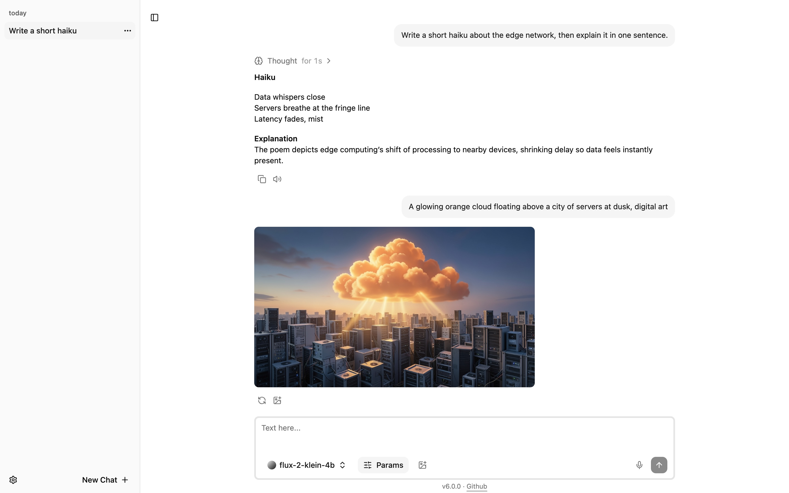

# Cloudflare AI Web

[中文](./README.md) ｜ English



## Deployment

### Vercel

[](https://vercel.com/new/clone?repository-url=https%3A%2F%2Fgithub.com%2FJazee6%2Fcloudflare-ai-web&demo-title=Cloudflare%20AI%20Web&demo-url=https%3A%2F%2Fai.vuiki.com)

Example: https://ai.vuiki.com

> It may not respond when the quota is used up, it is recommended to deploy it yourself

### Cloudflare Workers

[](https://deploy.workers.cloudflare.com/?url=https://github.com/Jazee6/cloudflare-ai-web)

Or build and deploy manually:

```bash
bun install
bun run cf:build
bun run cf:deploy
```

### Docker

```bash
docker run -d --name cloudflare-ai-web \
  -e CF_ACCOUNT_ID=YOUR_CF_ACCOUNT_ID \
  -e CF_WORKERS_AI_TOKEN=YOUR_CF_WORKERS_AI_TOKEN \
  -p 3000:3000 \
  --restart=always \
  jazee6/cloudflare-ai-web
```

## Features

- Built on TanStack Start (SPA mode); one codebase deploys statelessly to Vercel, Docker, and Cloudflare Workers
- Quickly build a multimodel AI platform using Cloudflare Workers AI
- External Models through Cloudflare AI Gateway (BYOK / Unified Billing / Gateway Routes)
- Personal Providers: visitors add their own provider key or their own AI Gateway in the browser and add Personal Models (text and image), fetched from the provider's model list or declared by hand
- Image generation inside conversations: select a `Text to Image` model, tune its params, and add up to 4 Reference Images (FLUX.2, OpenAI Images, Gemini image output)
- Model layout: hide models and arrange them into custom, ordered groups (stored locally)
- Document parsing (Workers AI `toMarkdown`, 0 Neurons) and webpage extraction (three-tier fallback + SSRF protection) across all chat models
- Read-only Cloudflare AI Search Knowledge Base retrieval (RAG) with lightweight Citations
- `/settings` pages: theme, Custom Instructions, gateway cache, webpage extraction, browser-native Web Speech ASR/TTS, Conversation History JSON export/import
- Chat history is stored locally (IndexedDB)
- Image attachments are resized in the browser (long edge up to 1568px, at most 512 KiB each, up to 5 per request) so requests fit the Vercel Functions body limit
- Access Session protection via deployment password

> **Note:** In public mode anyone can use your inference APIs. Set `APP_PASSWORD` to enable Access Session.

## Deployment Instructions

### Environment Variables

Every variable is optional. With none set, visitors can still chat through Personal Providers on their own AI Gateway.

| Name                       | Description                                                             | Needed for                    |
| -------------------------- | ----------------------------------------------------------------------- | ----------------------------- |
| CF_ACCOUNT_ID              | Cloudflare Account ID                                                   | Workers AI / gateway          |
| CF_WORKERS_AI_TOKEN        | Cloudflare Workers AI Token (inference & `toMarkdown` document parsing) | Workers AI models / documents |
| CF_AI_GATEWAY_NAME         | Cloudflare AI Gateway Name                                              | Gateway / External Models     |
| CF_AI_GATEWAY_TOKEN        | Cloudflare AI Gateway Auth Token                                        | Gateway / External Models     |
| CF_AI_GATEWAY_MODELS       | Declarative External Models & Gateway Routes                            | External Models               |
| CF_BROWSER_RUN_TOKEN       | Cloudflare Browser Run `/markdown` token (SPA dynamic fallback)         | Optional                      |
| CF_AI_SEARCH_TOKEN         | Cloudflare AI Search read-only retrieval token                          | Knowledge Base                |
| CF_AI_SEARCH_INSTANCES     | Allowlisted AI Search instances (`id` or `id:Display Name`)             | Knowledge Base                |
| CF_AI_SEARCH_NAMESPACE     | AI Search namespace (default `default`)                                 |                               |
| CF_AI_SEARCH_REWRITE_QUERY | Enable AI Search `rewrite_query` (default `false`)                      |                               |
| APP_PASSWORD               | Access Password (Access Session)                                        | Recommended                   |

#### CF_WORKERS_AI_TOKEN

- Manage Account - Account API Tokens - Create Token - Create with Workers AI template

#### CF_AI_GATEWAY_MODELS (BYOK / Unified Billing)

Configure upstream provider keys in Cloudflare Dashboard → **AI** → **AI Gateway** → **Provider Keys (BYOK)**, then declare models in `CF_AI_GATEWAY_MODELS`:

```bash
CF_AI_GATEWAY_MODELS="google-ai-studio/gemini-4-hydrogen?name=Gemini+4+Hydrogen&input=image,search&contextWindow=1048576,openai/gpt-5?input=image&reasoning=true&contextWindow=400000,dynamic/smart-chat?name=Smart+Chat"
```

Supported query parameters: `name`, `input` (`image` / `search`), `reasoning` (`true` / `false`), `contextWindow`, `byokAlias`.

#### Personal Providers

Visitors add Personal Providers under **Settings → Providers**. Credentials are stored in plaintext in the browser's localStorage and sent with each request, which the server forwards through AI Gateway. The server never stores them, logs them, or includes them in backups.

- **Through this deployment's gateway**: requires `CF_ACCOUNT_ID`, `CF_AI_GATEWAY_NAME`, and `CF_AI_GATEWAY_TOKEN`. Visitors **must** provide their own provider key and cannot use `dynamic/*` routes, so the deployer's BYOK keys and credits are never used.
- **Through the visitor's own gateway**: Account ID, Gateway name, and an optional token. The provider key is optional (the visitor's gateway BYOK / Unified Billing applies), and `dynamic/*` routes are allowed.

## Sponsor

[Click Me](https://jaze.top/sponsor)
