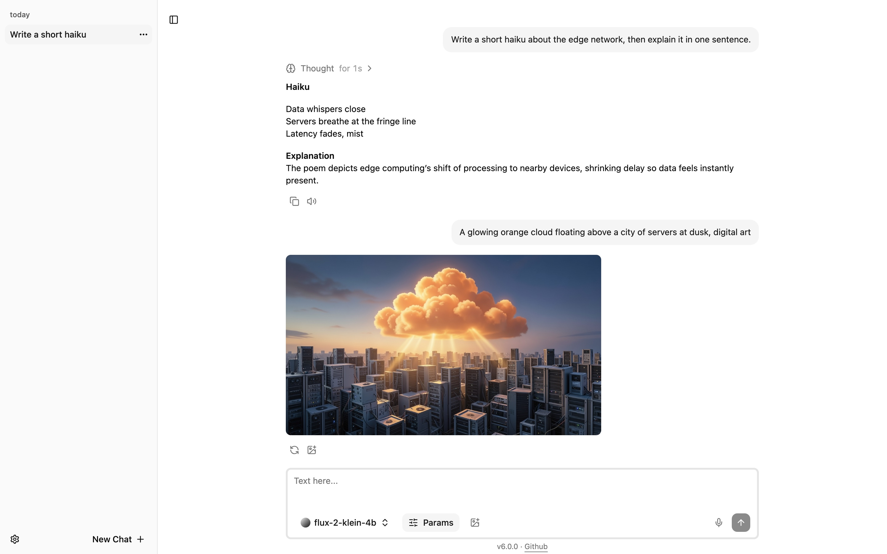

# Cloudflare AI Web

中文 ｜ [English](./README.en.md)

基于 Cloudflare Workers AI 与 AI Gateway 的多模型 AI 对话平台，可部署到 Vercel、Cloudflare Workers 和 Docker。

示例：[ai.vuiki.com](https://ai.vuiki.com)（额度可能用完，建议自行部署）



## 特性

- Workers AI 模型开箱即用，通过 AI Gateway 接入外部模型（BYOK / Unified Billing / Gateway Route）
- Personal Provider：访客用自己的 Key 或 AI Gateway 添加模型
- 会话内生图，支持参数调节与最多 4 张参考图
- 文档解析、网页提取、AI Search 知识库检索（RAG）
- 语音输入与朗读、自定义系统提示词、模型分组排序
- 数据只存于浏览器本地，支持导出/导入
- PWA 离线可用，支持访问密码

## 部署

> [!WARNING]
> 未设置 `APP_PASSWORD` 时，任何人都能调用你的推理 API。

### Vercel

[](https://vercel.com/new/clone?repository-url=https%3A%2F%2Fgithub.com%2FJazee6%2Fcloudflare-ai-web&demo-title=Cloudflare%20AI%20Web&demo-url=https%3A%2F%2Fai.vuiki.com)

从 5.x 升级：在 **Settings → Build and Deployment** 中把 Framework Preset 改为 **Other**，并清除自定义构建设置。

### Cloudflare Workers

[](https://deploy.workers.cloudflare.com/?url=https://github.com/Jazee6/cloudflare-ai-web)

或本地部署：

```bash
bun install
bun run deploy
```

### Docker

```bash
docker run -d --name cloudflare-ai-web \
  -e CF_ACCOUNT_ID=YOUR_CF_ACCOUNT_ID \
  -e CF_WORKERS_AI_TOKEN=YOUR_CF_WORKERS_AI_TOKEN \
  -p 3000:3000 \
  --restart=always \
  jazee6/cloudflare-ai-web
```

## 环境变量

均为可选。不配置时，访客仍可通过 Personal Provider 使用。

| 名称                         | 描述                                               |
| ---------------------------- | -------------------------------------------------- |
| `CF_ACCOUNT_ID`              | Cloudflare 账户 ID                                 |
| `CF_WORKERS_AI_TOKEN`        | Workers AI 令牌                                    |
| `CF_AI_GATEWAY_NAME`         | AI Gateway 名称                                    |
| `CF_AI_GATEWAY_TOKEN`        | AI Gateway 令牌                                    |
| `CF_AI_GATEWAY_MODELS`       | 外部模型声明，见下文                               |
| `CF_AI_SEARCH_TOKEN`         | AI Search 令牌，启用知识库                         |
| `CF_AI_SEARCH_INSTANCES`     | 可用的 AI Search 实例，逗号分隔，`id` 或 `id:别名` |
| `CF_AI_SEARCH_NAMESPACE`     | AI Search 命名空间，默认 `default`                 |
| `CF_AI_SEARCH_REWRITE_QUERY` | 开启 `rewrite_query`，默认 `false`                 |
| `CF_BROWSER_RUN_TOKEN`       | Browser Run 令牌，用于提取动态网页                 |
| `APP_PASSWORD`               | 访问密码                                           |
| `APP_ANNOUNCEMENT`           | 公告，见下文                                       |
| `SITE_URL`                   | 站点地址，构建时读取，见下文                       |

### CF_WORKERS_AI_TOKEN

Dashboard → **管理账户 → 账户 API 令牌 → 创建令牌**，选 **Workers AI** 模板。

### CF_AI_GATEWAY_MODELS

先在 Dashboard → **AI → AI Gateway → Provider Keys (BYOK)** 配置密钥，再用逗号分隔声明模型：

```bash
CF_AI_GATEWAY_MODELS="google-ai-studio/gemini-4-hydrogen?name=Gemini+4+Hydrogen&input=image,search&contextWindow=1048576,openai/gpt-5?input=image&reasoning=true&contextWindow=400000,dynamic/smart-chat?name=Smart+Chat"
```

参数：`name`、`input`（`image` / `search`）、`reasoning`、`contextWindow`、`byokAlias`。

### APP_ANNOUNCEMENT

右上角公告，关闭后内容变化时才再次出现：

```bash
APP_ANNOUNCEMENT='{"title":"新功能上线","description":{"en":"...","zh-CN":"..."},"url":"https://..."}'
```

### SITE_URL

如 `https://ai.example.com`，用于 canonical、分享卡片和 sitemap。构建时写入，修改后需重新构建：

- Vercel / Workers Builds：配置为构建环境变量
- Docker：`docker build --build-arg SITE_URL=https://ai.example.com .`

### Personal Provider

访客在 **设置 → Providers** 中添加，凭据只存于浏览器，服务端不保存也不记录。

- **经本部署的网关**：需配置网关相关变量；访客必须填写自己的 Key，且不能使用 `dynamic/*`，不会消耗你的额度
- **经访客自己的网关**：Key 可选，可使用 `dynamic/*`

## 赞助

<div align="center">


[Doloffer--站式数字订阅充值平台](https://doloffer.com)

主营 GPT、Claude 等 AI多类数字服务会员正版订阅，9 折优惠码 AI8888，极速发货，售后无忧

</div>
